

# Bookly — Ứng Dụng Đọc Light Novel

**Khám phá thế giới Light Novel hiện đại, mượt mà và giàu cảm xúc trên Android**

---

  
  
  

  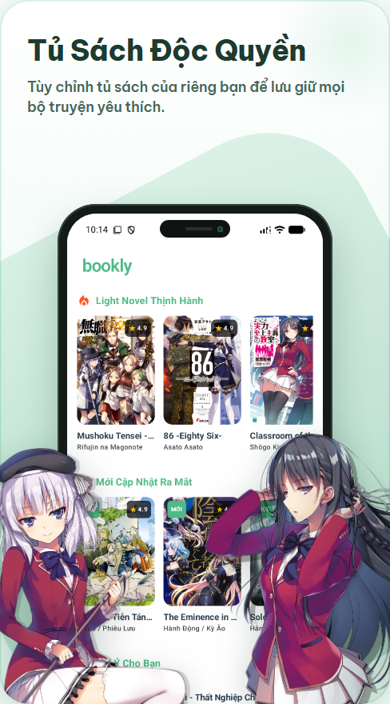
  
  

  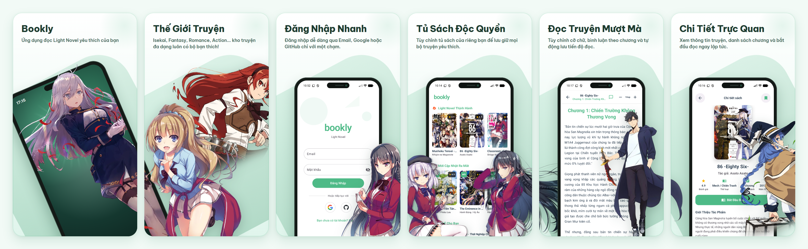

---

## ✨ Giới Thiệu Về Bookly

**Bookly** là ứng dụng đọc **Light Novel** trên nền tảng Android, được thiết kế dành riêng cho những độc giả yêu thích văn hóa Light Novel & Anime (*Isekai, Fantasy, Romance, Action, Comedy, Slice of Life, Sci-Fi...*).

Lấy cảm hứng từ sắc **Xanh Ngọc – Trắng (`#4EBA87`)** tươi mát và dịu mắt, Bookly mang đến một không gian đọc sách trực quan, hiện đại và hoàn toàn tập trung vào nội dung:

- 🌿 **Giao diện tinh tế, thân thiện với mắt**: Kết hợp ngôn ngữ thiết kế **Material Design 3** cùng các họa tiết trang trí vẽ tay trên nền Canvas độc quyền, hỗ trợ chuyển đổi linh hoạt giữa **Chế độ Sáng (Light Mode)** và **Chế độ Tối (Dark Mode)**.
- 📚 **Kho truyện phong phú & cập nhật liên tục**: Đồng bộ dữ liệu trực tiếp theo thời gian thực, giúp người đọc không bỏ lỡ bất kỳ chương truyện mới nào.
- 🎯 **Cá nhân hóa trọn vẹn hành trình đọc**: Từ tủ sách yêu thích, lịch sử chương đang đọc dở cho đến bảng thống kê tiến độ hoàn thành của từng bộ truyện.
- 💬 **Kết nối cộng đồng độc giả**: Thảo luận và chia sẻ cảm nhận trực tiếp tại từng chương truyện.

---

## 📱 Trải Nghiệm Chi Tiết Trên Bookly

### 1. Khám Phá Kho Truyện & Tìm Kiếm Thông Minh

Từ màn hình chính, người dùng có thể dễ dàng tiếp cận hàng loạt bộ Light Novel đặc sắc được phân mục rõ ràng hoặc tra cứu nhanh tác phẩm yêu thích:

- **🏠 Trang Chủ (Home)**: Tổng hợp các chuyên mục *Light Novel Thịnh Hành*, *Mới Cập Nhật Ra Mắt* và *Gợi Ý Cho Bạn* với ảnh bìa sắc nét và điểm đánh giá trực quan.
- **📚 Tủ Sách & Bộ Lọc Thể Loại (Library)**: Hỗ trợ tìm kiếm tức thì theo **tên truyện** hoặc **tác giả**, kết hợp thanh lọc nhanh theo từng thể loại (*Isekai, Fantasy, Romance, Action, Comedy, Drama...*).
- **📖 Chi Tiết Tác Phẩm (Book Detail)**: Cung cấp đầy đủ thông tin về tác giả, thể loại, điểm đánh giá, tổng số chương, phần giới thiệu nội dung và danh sách chương chi tiết. Ứng dụng tự động nhận diện tiến độ để hiển thị nút **“Đọc từ đầu”** hoặc **“Đọc tiếp Chương X”**.

<table>
  <tr>
    <td align="center" width="33.3%">
      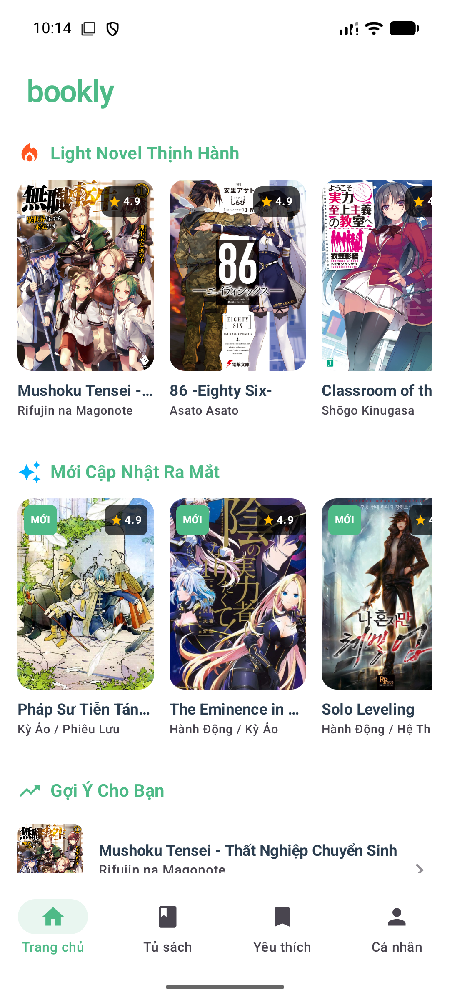
       
      <b>🏠 Trang Chủ Khám Phá</b>
       
      Tổng hợp truyện thịnh hành, mới ra mắt và đề xuất cá nhân hóa.
    </td>
    <td align="center" width="33.3%">
      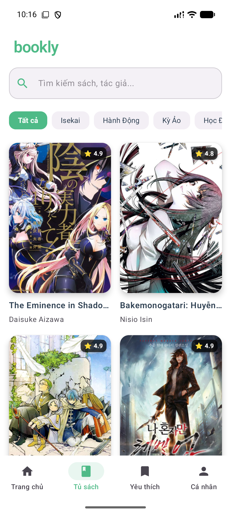
       
      <b>📚 Tủ Sách & Bộ Lọc</b>
       
      Tìm kiếm tức thì theo tên sách, tác giả và lọc theo thể loại.
    </td>
    <td align="center" width="33.3%">
      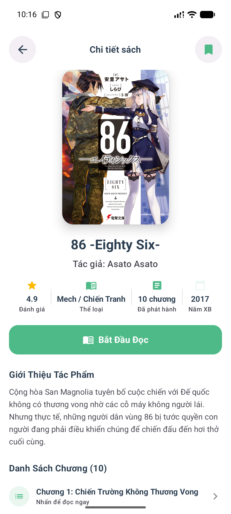
       
      <b>📖 Thông Tin Tác Phẩm</b>
       
      Xem giới thiệu cốt truyện, đánh giá và danh sách chương đầy đủ.
    </td>
  </tr>
</table>

---

### 2. Trình Đọc Mượt Mà, Bình Luận Theo Chương & Theo Dõi Tiến Độ

Trái tim của **Bookly** là trải nghiệm đọc sâu, thoải mái trong thời gian dài cùng khả năng lưu giữ hành trình đọc tự động:

- **📝 Trình Đọc Chương (Chapter Reader)**:
  - Tùy chỉnh kích thước chữ linh hoạt (`12sp` – `28sp`) ngay trên thanh công cụ để phù hợp với mọi kích cỡ màn hình.
  - Bố cục dòng thoáng đãng, chuyển tiếp nhanh giữa *Chương trước* / *Chương tiếp* và đánh dấu hoàn thành khi đọc tới chương cuối cùng.
- **💬 Thảo Luận Theo Từng Chương (Real-time Comments)**:
  - Hiển thị số lượng bình luận ngay trên thanh tiêu đề chương.
  - Khung thảo luận trượt lên mượt mà, đồng bộ bình luận theo thời gian thực để độc giả cùng bàn luận tình tiết truyện mà không cần rời khỏi trang đọc.
- **🔖 Tủ Sách Yêu Thích & Thống Kê Tiến Độ (Bookmarks & Progress)**:
  - Lưu trữ các bộ truyện yêu thích vào tủ sách cá nhân chỉ với một chạm.
  - Bảng thống kê trực quan hiển thị tổng số sách đã lưu, phần trăm hoàn thành toàn bộ tủ sách và phân loại chi tiết trạng thái: **Đang đọc**, **Đã xong**, **Chưa đọc**.

<table>
  <tr>
    <td align="center" width="33.3%">
      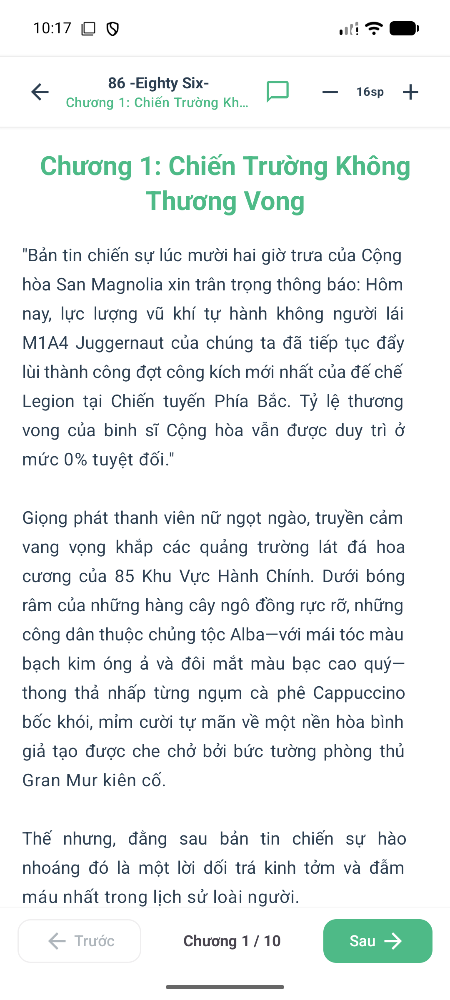
       
      <b>📝 Trình Đọc Tùy Biến</b>
       
      Điều chỉnh cỡ chữ linh hoạt, tự động lưu vị trí chương đang đọc.
    </td>
    <td align="center" width="33.3%">
      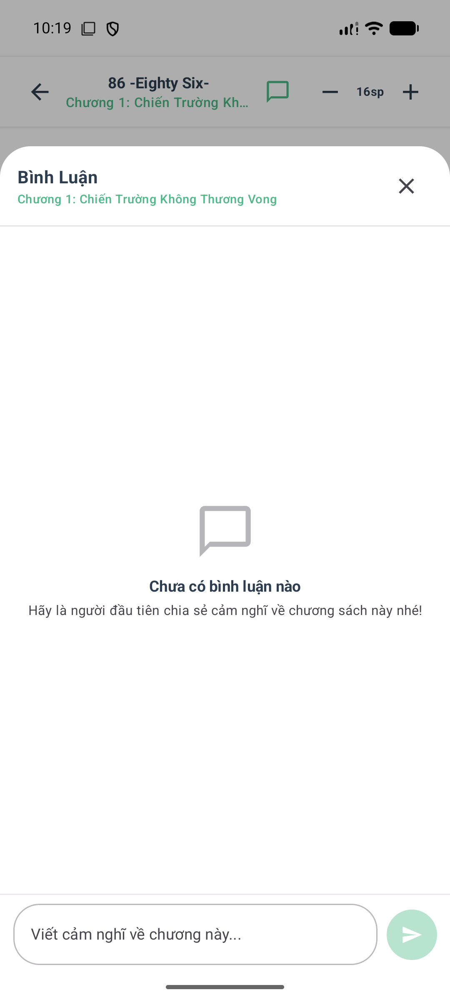
       
      <b>💬 Bình Luận Thời Gian Thực</b>
       
      Giao lưu và chia sẻ cảm nhận với cộng đồng độc giả ở từng chương.
    </td>
    <td align="center" width="33.3%">
      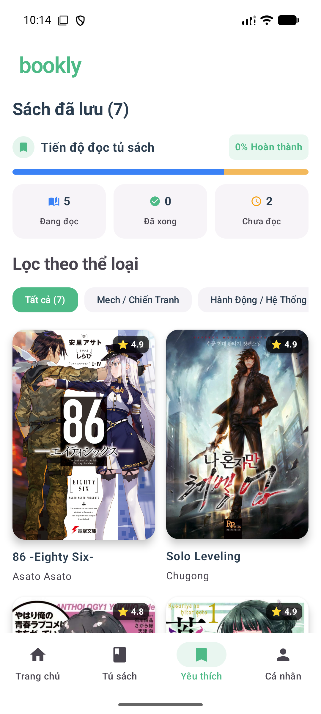
       
      <b>🔖 Tủ Sách & Tiến Độ Đọc</b>
       
      Theo dõi phần trăm hoàn thành và mở lại nhanh chương đang đọc dở.
    </td>
  </tr>
</table>

---

### 3. Đăng Nhập Nhanh & Chế Độ Sáng / Tối Bảo Vệ Mắt

- **🔐 Đăng Nhập Đa Phương Thức**: Hỗ trợ đăng nhập nhanh chóng qua **Email & Mật khẩu** (tích hợp xác thực mã bảo mật OTP 6 số gửi qua Email), hoặc đăng nhập một chạm bằng tài khoản **Google** và **GitHub**.
- **🌓 Giao Diện Sáng & Tối (Dynamic Light & Dark Mode)**: Chuyển đổi tức thì giữa giao diện **Sáng (Mint-White)** thanh lịch ban ngày và giao diện **Tối (Dark Slate)** êm dịu khi đọc truyện vào ban đêm.

<table>
  <tr>
    <td align="center" width="25%">
      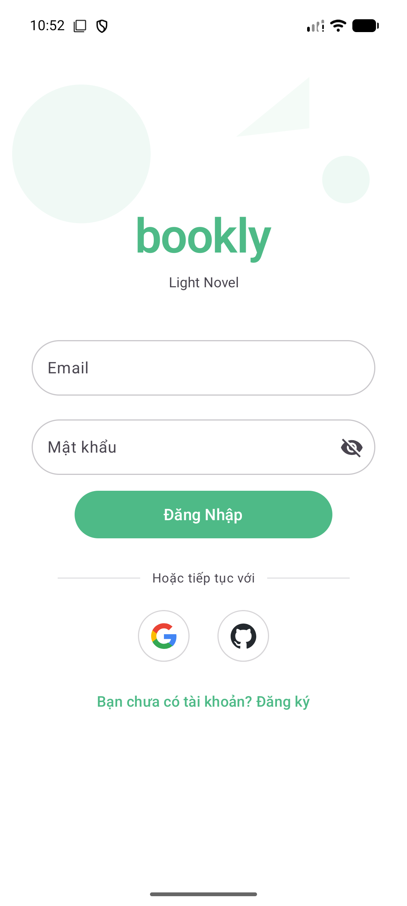
       
      <b>🔐 Đăng Nhập Nhanh</b>
       
      Email OTP, Google & GitHub
    </td>
    <td align="center" width="25%">
      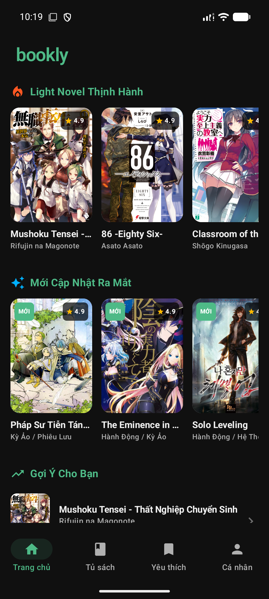
       
      <b>🌙 Trang Chủ (Dark Mode)</b>
       
      Giao diện tối dịu mắt ban đêm
    </td>
    <td align="center" width="25%">
      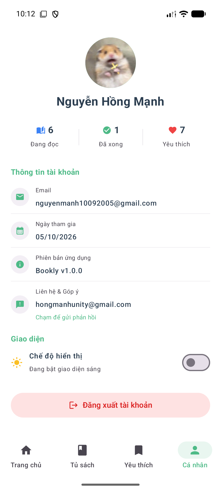
       
      <b>☀️ Hồ Sơ (Light Mode)</b>
       
      Quản lý tài khoản & tùy chọn
    </td>
    <td align="center" width="25%">
      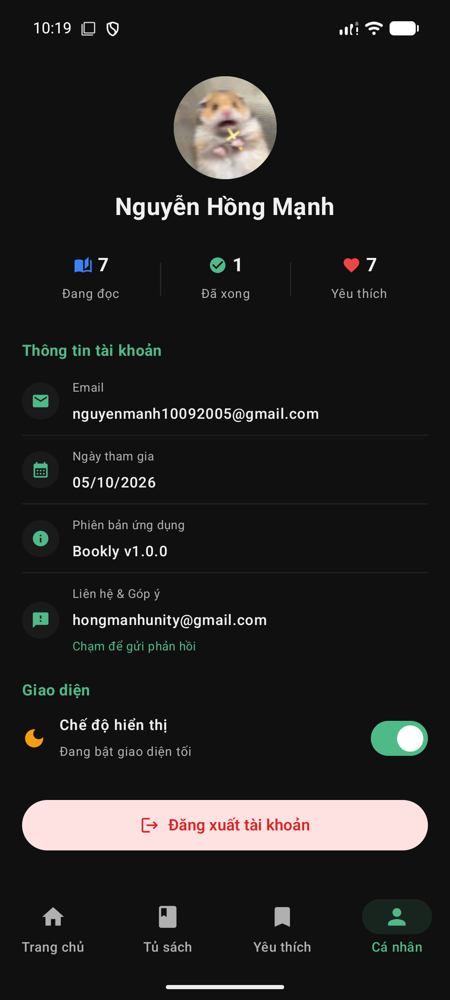
       
      <b>🌙 Hồ Sơ (Dark Mode)</b>
       
      Chuyển đổi giao diện một chạm
    </td>
  </tr>
</table>

---

## 🛠 Công Nghệ Đứng Sau Trải Nghiệm Bookly

| Thành phần | Công nghệ sử dụng | Vai trò trong ứng dụng |
| :--- | :--- | :--- |
| **Nền tảng & Ngôn ngữ** | **Kotlin 2.0** + **Coroutines & Flow** | Xử lý bất đồng bộ mượt mà, phản hồi tức thì mọi thao tác của người đọc |
| **Giao diện người dùng** | **Jetpack Compose (Material Design 3)** | Thiết kế giao diện hiện đại, hiệu ứng chuyển cảnh mượt và họa tiết Canvas |
| **Đám mây & Thời gian thực** | **Cloud Firestore** | Đồng bộ danh mục Light Novel, nội dung chương và bình luận theo thời gian thực |
| **Xác thực người dùng** | **Firebase Auth + Credential Manager + SMTP OTP** | Đăng nhập đa phương thức qua Email OTP, Google Sign-In và GitHub OAuth |
| **Lưu trữ trên thiết bị** | **Room Database (SQLite)** | Lưu trữ tủ sách yêu thích và ghi nhớ chính xác tiến độ đọc của từng tác phẩm |
| **Xử lý hình ảnh** | **Coil 3** | Tải và đệm ảnh bìa Light Novel chất lượng cao với tốc độ nhanh |

---

  <b>Bookly — Ứng dụng đọc Light Novel yêu thích của bạn</b>
   
  Thiết kế & phát triển với ❤️ trên nền tảng Android (Kotlin & Jetpack Compose)

